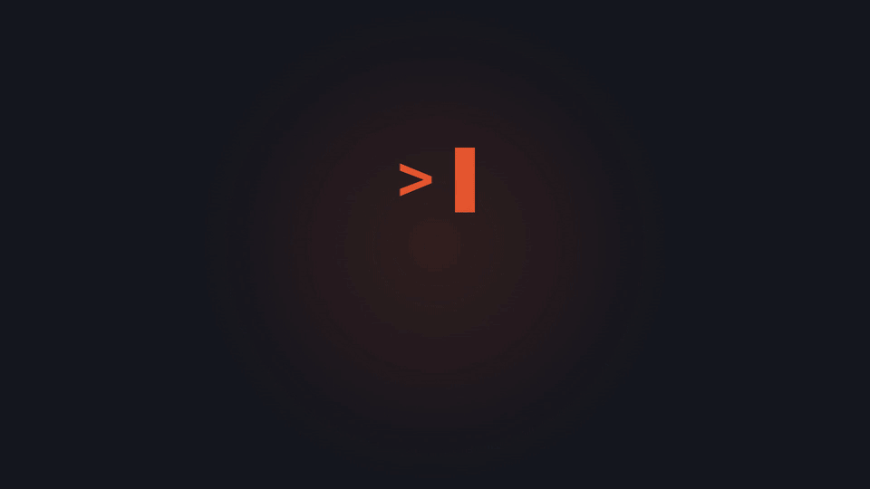
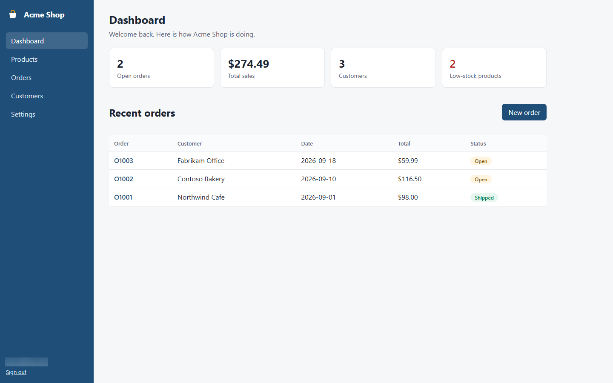
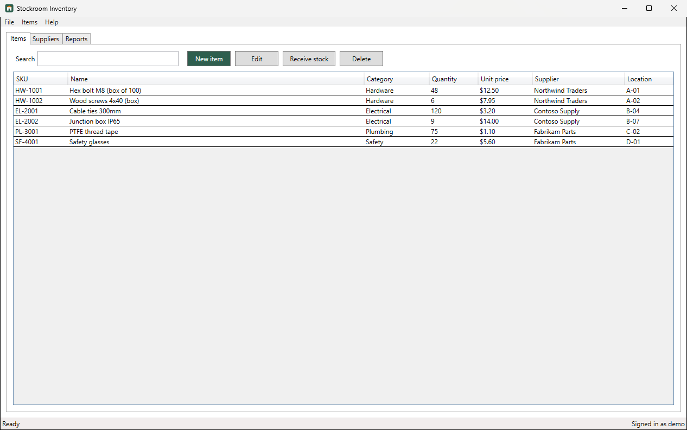
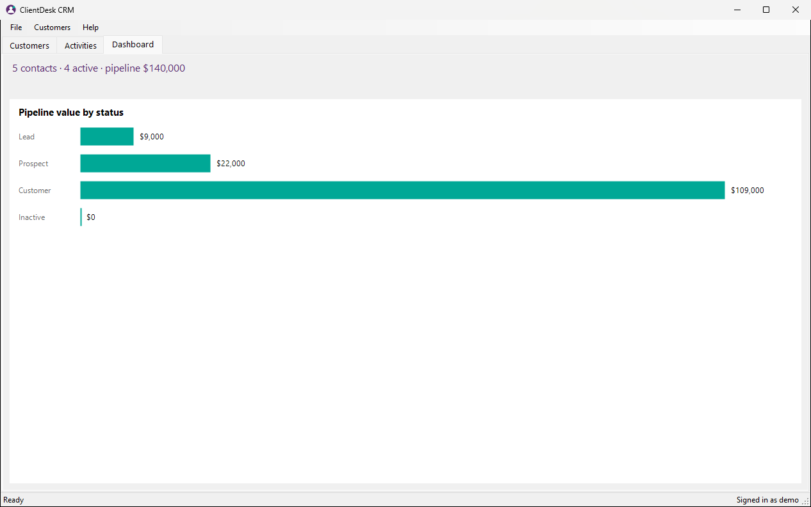

<div align="center">

# GuideGen

**Your app's user manual, written by your coding agent.**

Type `/guidegen` and get a finished, branded manual for your web or Windows desktop app:<br>
a Word document and a searchable HTML site, with annotated screenshots, step-by-step how-to guides,<br>
a reference for every screen, and troubleshooting.

[](https://github.com/Urjitpatel28/GuideGen/actions/workflows/ci.yml)
[](LICENSE)
[](https://agentskills.io)
[](#what-it-documents)
[](https://www.python.org/)

[Install](#install) · [Use](#use) · [Sample manuals](#sample-manuals) · [Safety](#safety) · [How it works](#how-it-works) · [Contributing](#contributing)

<a href="docs/media/guidegen-demo.mp4">
  
</a>

<sub>▶ <a href="docs/media/guidegen-demo.mp4">Watch the 23-second video with sound</a></sub>

</div>

---

## What you get

<table>
  <tr>
    <td width="50%" valign="top">
      <h3>🧭 Reads your code, runs your app</h3>
      Your agent works out which screens exist and which tasks matter, then starts the app and explores
      every screen itself. No hand-written config.
    </td>
    <td width="50%" valign="top">
      <h3>📸 Annotated, redacted screenshots</h3>
      Every step gets a screenshot with the control highlighted and numbered. Passwords and email addresses
      are blurred in memory before anything is written to disk.
    </td>
  </tr>
  <tr>
    <td width="50%" valign="top">
      <h3>📘 Word + HTML, with your branding</h3>
      A <code>.docx</code> with a real table of contents and a searchable HTML site, both with your logo,
      product name and colors.
    </td>
    <td width="50%" valign="top">
      <h3>🔁 <code>--update</code> keeps your edits</h3>
      After a release, only changed screens are captured again. Your overrides, exclusions and locked fields
      are never touched.
    </td>
  </tr>
</table>

GuideGen is an open-source (MIT) [agent skill](https://agentskills.io). Your agent (Claude Code, Codex, Cursor,
opencode) does the understanding and writes in plain language for your customers. A bundled Python engine does the
mechanics: it drives the app (Playwright for web and Electron, UI Automation for WPF/WinForms/WinUI), replays recorded
steps, blurs secrets, and renders Word and HTML.

### What it documents

| | |
|---|---|
| **Web apps** | Next.js, React/Vite, Angular, Vue/Nuxt, SvelteKit, ASP.NET MVC / Razor Pages / Blazor |
| **Windows desktop** | WPF, WinForms, WinUI 3, Electron |
| **Output** | `guidegen-out/manual.docx`, `guidegen-out/manual-html/index.html`, `guidegen-out/run-report.md` |

## Sample manuals

Generated from the bundled example apps, with no hand-written config.

<table>
  <tr>
    <td width="33%" align="center" valign="top">
      <br>
      <b>Acme Shop</b><br>
      <sub>Next.js web app · 11 screens · 10 tasks</sub><br>
      <a href="docs/samples/nextjs-shop/index.html">HTML</a> ·
      <a href="docs/samples/nextjs-shop/manual.docx">Word</a> ·
      <a href="docs/samples/nextjs-shop/run-report.md">Run report</a>
    </td>
    <td width="33%" align="center" valign="top">
      <br>
      <b>Stockroom Inventory</b><br>
      <sub>WPF desktop app · 9 screens · 10 tasks</sub><br>
      <a href="docs/samples/wpf-inventory/index.html">HTML</a> ·
      <a href="docs/samples/wpf-inventory/manual.docx">Word</a> ·
      <a href="docs/samples/wpf-inventory/run-report.md">Run report</a>
    </td>
    <td width="33%" align="center" valign="top">
      <br>
      <b>ClientDesk CRM</b><br>
      <sub>WinForms desktop app · 8 screens · 9 tasks</sub><br>
      <a href="docs/samples/winforms-crm/index.html">HTML</a> ·
      <a href="docs/samples/winforms-crm/manual.docx">Word</a> ·
      <a href="docs/samples/winforms-crm/run-report.md">Run report</a>
    </td>
  </tr>
</table>

## Install

**Claude Code**
```
/plugin marketplace add Urjitpatel28/guidegen
/plugin install guidegen@guidegen
```

**Any agent** (Cursor, Codex, opencode, ...), via [skills.sh](https://skills.sh):
```
npx skills add https://github.com/Urjitpatel28/guidegen --skill guidegen
```

**Manual**: copy `skills/guidegen/` into your agent's skills folder (`~/.claude/skills/`, `.agents/skills/`,
`.opencode/skills/`).

> [!NOTE]
> **Requirements**: [uv](https://docs.astral.sh/uv/) (the engine installs itself on first run), Python 3.11+ (uv can
> fetch it), and a Chromium browser. `guidegen doctor` installs Playwright's Chromium, or uses Microsoft Edge or
> Chrome if they are already installed. Windows desktop apps can only be documented on Windows. Web apps work on
> Windows, macOS and Linux.

> [!TIP]
> To use the skill while working in this repo, create the skill discovery links (`.claude/skills/guidegen`,
> `.agents/skills/guidegen`, `.opencode/skills/guidegen` pointing to `skills/guidegen`) with
> `scripts/link-skills.sh` (macOS/Linux) or `scripts/link-skills.ps1` (Windows). On Windows the script makes
> symlinks when Developer Mode allows it; otherwise it makes junctions, which work locally but are never committed.

## Use

```
/guidegen                      # full run (first asks once if you have an old manual, outline or doc standard)
/guidegen --brief docs/old-manual.docx --brief https://help.example.com/start   # follow these, don't ask
/guidegen --no-brief           # work from the code alone
/guidegen --update             # after a release: keep your edits, re-capture only changed screens
/guidegen --only orders-list   # just these screens/tasks
/guidegen --max-screens 30 --max-tasks 10 --format docx,html --out docs/manual
```

Everything it creates lives in `guidegen-out/` in your repo root. That folder has its own `.gitignore`, which keeps
only `guidegen.config.json`, `manual.yaml` and `brief.md` for you to commit. GuideGen never edits any other file.

<details>
<summary><b>Start from what you already have</b> (old manual, reference manual, outline, doc standard)</summary>
<br>

On the first run GuideGen asks one question before it reads any code: do you have an **old manual**, a
**reference manual** whose style you like, a **rough outline** (chapters, tasks, what to skip) or a **documentation
process** (audience, tone, terms)? Give file paths (.docx, .pdf, .md, .txt, .html), URLs, or paste text, or say
"none".

- An old manual of the same product keeps its chapter order, task list, terms and good wording. Every step is still
  re-checked in the live app and every screenshot is new. Tasks the app no longer has are listed in the run report.
- A reference manual only lends its style. Its content is never copied.
- An outline sets chapter order, custom chapters (a glossary, "About this manual"), task groups and what to leave out.

The answer is saved (`brief` in `guidegen.config.json` and a short `guidegen-out/brief.md`), so no later run asks
again. `--ask-brief` asks again.

</details>

<details>
<summary><b>When GuideGen asks a question</b></summary>
<br>

After that, GuideGen only stops when it truly cannot continue: the build fails, the app has no test login, or the backend
isn't local. It asks exactly one question and saves the answer (env var **names** only) to
`guidegen-out/guidegen.config.json`, so the next run asks nothing.

</details>

<details>
<summary><b>Editing the manual</b></summary>
<br>

`guidegen-out/manual.yaml` is the source of truth. Edit it and re-run `/guidegen --update`:

- `override:` replaces generated text (screen `text.override`, task, step or troubleshooting entry)
- `exclude: true` drops a screen, task, entry or chapter
- `chapters:` sets the chapter order; add your own text chapters with an `id`, `title` and `body`
- `locked: [title]` keeps a field you edited directly
- add `navigate:` steps to reach a screen GuideGen reported as unreachable

GuideGen never changes `override`, `exclude` or `locked`, and it keeps your YAML comments.

The Word file uses a real table-of-contents field, so Word asks to *update fields* the first time you open it. Say yes.

</details>

## Safety

Running GuideGen runs your app's own build and start commands with your permissions, just as if you ran them yourself.
On top of that, the engine (not just the instructions to the agent) enforces:

- **Localhost only.** It refuses to start if the app URL or a connection string in `appsettings.Development.json`,
  `.env` or `.env.local` points to a non-local host, unless you set `safety.allowRemoteBackends`.
- **No destructive clicks.** Buttons named like delete, remove, pay, buy, checkout, send, email, publish, reset,
  transfer, unsubscribe, deactivate or drop are refused unless listed in `safety.allowDestructive`. The step
  is still documented, with a screenshot of the state before the click.
- **Redaction before disk.** Password fields, email addresses (configurable patterns) and selectors you list are
  blurred in memory, and raw screenshots are never written. Text drawn inside images or custom-drawn controls
  cannot be detected, so use seed data with fake values and review the screenshots before publishing.
- **Secrets stay in env vars.** Only variable names are stored, and resolved values are masked in every log.
- **Loopback session.** The driver daemon listens on 127.0.0.1 with a random per-session token.
- **No telemetry** and no network calls except to your local app (and the one-time browser download).

App text is treated as data, never as instructions to the agent.

## How it works

The skill owns understanding (which screens exist, which tasks matter, the words). The bundled engine owns mechanics
(running and driving the app, deterministic replay, redaction, annotation, rendering).

```
/guidegen -> agent (SKILL.md)                     engine (uv run guidegen ...)
  0 brief    (asks once for an old manual, outline or standard) ... brief extract
  1 doctor ..................................... environment check
  2 detect ..................................... app kind, build/start, URL or .exe
  3 start ...................................... build, seed, start, wait, login
  4 inventory (reads code, recipes per framework)
  5 explore  (tree / act / shot) ............... session daemon drives the app
  6 plan 8-15 tasks from E2E tests, form dependencies, README, graphify
  7 capture .................................... deterministic replay, redact, annotate
  8 write plain-language text
  9 brand ...................................... logo, names, colors
 10 render ..................................... Word + HTML
 11 report ..................................... run-report.md
```

Details: [`skills/guidegen/SKILL.md`](skills/guidegen/SKILL.md) and [`skills/guidegen/references/`](skills/guidegen/references/).
Architecture diagram: [`docs/architecture/guidegen-architecture.html`](docs/architecture/guidegen-architecture.html).
Specs: [`docs/01-prd.md`](docs/01-prd.md) to [`docs/05-feature-tickets.md`](docs/05-feature-tickets.md).

## Examples (benchmark suite)

| Example | Stack | Covers |
|---|---|---|
| [`examples/nextjs-shop`](examples/nextjs-shop) | Next.js 15 | login, seed data, 11 screens, Playwright E2E tests as evidence |
| [`examples/wpf-inventory`](examples/wpf-inventory) | WPF MVVM | PasswordBox, dialogs, menus, FlaUI UI tests |
| [`examples/winforms-crm`](examples/winforms-crm) | WinForms | ToolStrip menus, DataGridView, a custom-drawn chart (no UI Automation) |

```
cd skills/guidegen/engine
uv run pytest            # unit tests
uv run ruff check        # lint (config in pyproject.toml)
uv run pytest -m e2e     # replays the examples end to end (desktop ones on Windows)
```

## Contributing

- A new web or desktop framework usually needs only a markdown recipe in
  `skills/guidegen/references/surface-inventory/`.
- A new driver implements `Driver` (see `references/driver-interface.md`).
- Keep `SKILL.md` short. Details go in `references/`.

## License

MIT licensed. See [LICENSE](LICENSE).

## Star History

<a href="https://www.star-history.com/?repos=urjitpatel28%2Fguidegen&type=date&legend=top-left">
 <picture>
   <source media="(prefers-color-scheme: dark)" srcset="https://api.star-history.com/chart?repos=urjitpatel28/guidegen&type=date&theme=dark&legend=top-left" />
   <source media="(prefers-color-scheme: light)" srcset="https://api.star-history.com/chart?repos=urjitpatel28/guidegen&type=date&legend=top-left" />
   
 </picture>
</a>
